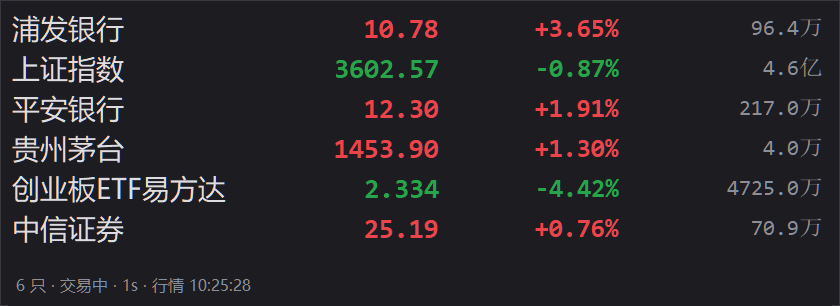
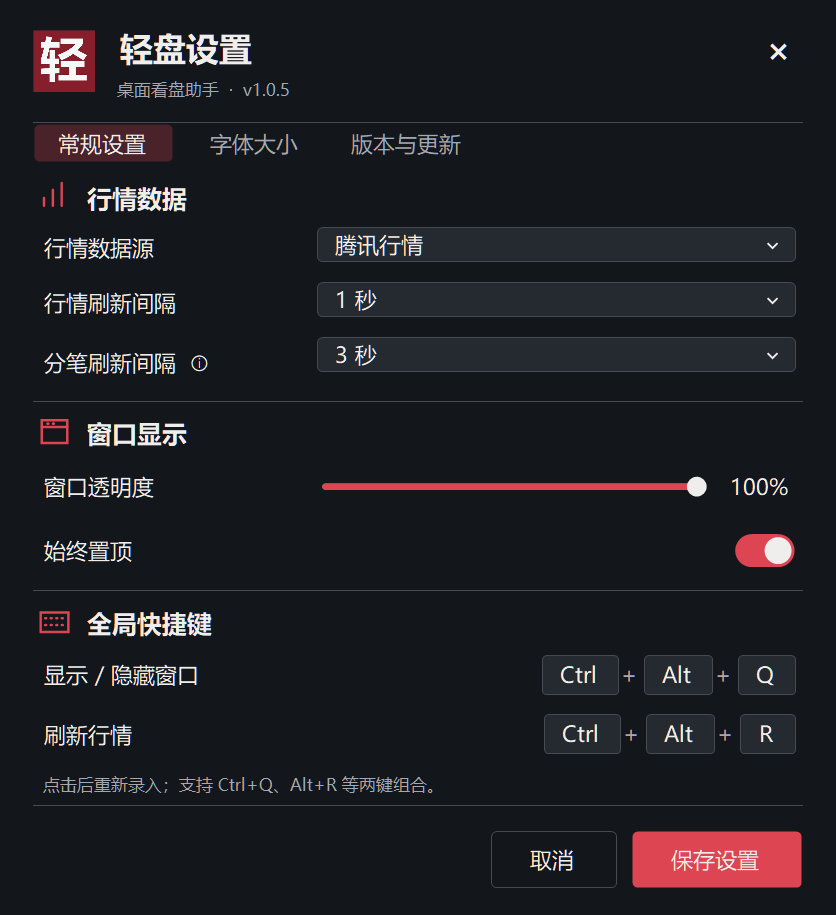
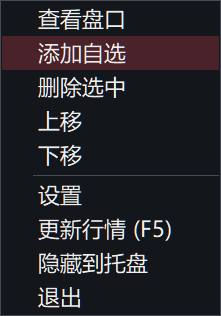
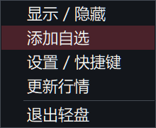

# 轻盘 · 桌面看盘助手

轻盘是一款轻量的桌面行情小窗，提供股票行情与盘口查看，支持自选股管理、数据源切换和个性化设置，以低资源占用和稳定刷新为核心。

轻盘是独立的 Windows 桌面程序，使用 **C# + WinForms / .NET Framework 4.8**。构建结果是一个 `LiteTicker.exe`，无需 Python、浏览器内核或 NuGet 运行时依赖。图标采用深红底色的“轻”字。

当前正式版：**[v1.0.5](https://github.com/Alexzzz2008/LiteTicker/releases/tag/v1.0.5)** · Windows · .NET Framework 4.8+

首次使用下载 [LiteTicker-win.zip](https://github.com/Alexzzz2008/LiteTicker/releases/download/v1.0.5/LiteTicker-win.zip)，解压后运行 `install.cmd`；已有运行环境可直接下载 [LiteTicker.exe](https://github.com/Alexzzz2008/LiteTicker/releases/download/v1.0.5/LiteTicker.exe)。

代理加速：[安装包](https://gh-proxy.com/https://github.com/Alexzzz2008/LiteTicker/releases/download/v1.0.5/LiteTicker-win.zip) · [单文件程序](https://gh-proxy.com/https://github.com/Alexzzz2008/LiteTicker/releases/download/v1.0.5/LiteTicker.exe)。

## 界面预览

以下为 v1.0.5 的实际程序界面，使用腾讯接口返回的 2026 年 11 月 16 日公开行情快照展示布局。

**桌面行情小窗**

**盘口、分时与五档**

**设置界面**

**添加自选**

**右键与托盘菜单**

| 右键菜单 | 托盘菜单 |
| --- | --- |
|  |  |

## 功能

- 无边框深色小窗，紧凑显示名称、现价、涨跌幅、成交量四列；成交量以手为单位，较大数值使用万、亿缩写。
- 字体与布局统一使用像素单位；列宽随窗口调整，添加或删除自选时自动调整高度，超过 12 行可滚动查看。
- 窗口不显示按钮条和表头；左键拖动窗口，拖动边缘调整尺寸，右键管理自选。
- 输入股票代码或拼音首字母，查看名称后选择添加；支持批量代码、删除自选、上移与下移，保存列表顺序。
- 参考桌面工具布局的深色设置页，使用红色强调、透明度滑条、置顶开关和可录入的快捷键；常规、字体、版本更新分区切换。
- 右键菜单、托盘菜单和添加自选页面统一为黑色、深红风格；菜单默认字号加大，并跟随全局字号缩放。
- 全局字号可调，行情列表和盘口可分别覆盖；字号与布局一起调整，保存后应用。
- 设置内显示当前版本，支持启动时自动检查和手动检查更新；下载校验通过后可重启更新，保留自选股和设置。
- 托盘常驻：隐藏后取消并暂停行情请求，重新显示立即刷新。
- 后台批量请求；同一轮刷新不重叠，切换数据源后丢弃旧请求的响应。
- 请求失败时保留已有有效报价，界面显示行情状态。
- 本地保存设置与窗口位置；重复启动只保留一个实例。
- 悬停股票或右键“查看盘口”打开大字侧边详情，支持分时、日 K、五档和成交；可固定、拖动和缩放，无横竖滚动条，空间不足时自动放在主窗左侧。
- 盘口打开即显示当前行情和缓存，切股、报价及成交刷新减少重复布局；重复点击搜索不会反复重发，自动和手动检查更新保持一致。
- 分时图按交易时间每小时画竖线，午休时段折叠；五档支持挂单手数／金额切换，金额按档位价格 × 手数 × 100 计算。
- 普通价格至少显示两位小数，仅在第三位有实际精度时保留第三位；刷新只修改变化的行情文字，底部时间更新保持布局稳定。

交易时段刷新间隔可选 1、2、3、5、10 秒，其他时间降为 30 秒。交易时段按北京时间和周末判断，暂不内置法定节假日日历。刷新间隔不等于行情接口的数据更新频率。

## 使用

- 首次安装推荐从 [最新版本](https://github.com/Alexzzz2008/LiteTicker/releases/latest) 下载 `LiteTicker-win.zip`，完整解压后运行 `install.cmd`；已有运行环境也可直接使用单个 `LiteTicker.exe`。
- 需要 **.NET Framework 4.8 或更新的 4.x 版本**；安装入口会检查环境，缺少时用中文提示，并可打开 [微软官方下载页](https://dotnet.microsoft.com/zh-cn/download/dotnet-framework/net48)。安装运行库后重新运行安装入口。
- 左键拖动小窗，拖动边缘缩放；右键股票行可删除、上移或下移自选，右键菜单也提供添加自选和设置入口。
- 悬停显示盘口，移出后自动隐藏；点击“固定”保持显示，点击“关闭”停止详情请求。选中股票后按 `Enter` 也可打开并固定盘口。
- 双击托盘图标显示窗口。托盘菜单提供显示／隐藏、设置、添加自选、更新行情和退出。
- 关闭窗口或按 `Alt+F4` 会隐藏到托盘；只有选择托盘菜单中的 **退出** 才会结束程序。
- 默认全局快捷键：`Ctrl+Alt+Q` 显示／隐藏，`Ctrl+Alt+R` 更新行情。
- 可在设置中录入其他快捷键，支持 `Ctrl+Q`、`Alt+R` 等两键组合，按 `Delete` 禁用对应快捷键。快捷键被其他程序占用时提示冲突，不保存这次设置。
- 设置中的“窗口透明度（%）”保存后立即生效，范围为 60–100；100 表示完全不透明，数值越小越透明。
- “分笔更新（秒）”可选 2 或 3，独立于主窗行情间隔；仅盘口打开时请求，非交易时段降为 30 秒。
- “字体大小”中设置全局字号；列表、盘口选择“跟随全局”或单独比例。其他界面按全局字号显示。
- “版本与更新”中可关闭启动检查，或手动检查、下载并重启。检查失败不会影响行情；关闭设置会取消正在进行的更新请求。

隐藏小窗会取消正在进行的请求并暂停刷新；重新显示后立即请求新行情。

详情仅在打开时请求。分时缓存 5 秒、日 K 缓存 60 秒；切换股票或数据源会取消旧请求，迟到结果不会重新打开已关闭的盘口。腾讯五档直接复用批量报价，近期分笔按页表定位最新页，每轮最多两次请求，共用 4 秒超时，失败不会退回早盘页。无分笔而有分时数据时，成交区明确显示“分钟成交 · 非逐笔”。当前东财适配未提供五档；详情接口失败会提示并标记保留数据，不切换其他来源冒充数据。

公开源分笔可能合并多次成交，2／3 秒是请求频率，不等同于交易所 Level-2 逐笔推送；成交区以源返回的实际时间显示，不补造秒数。

本版可选腾讯和东财，默认使用腾讯；东财部分详情接口可能不可用。新浪尚未接入本版。

## 本地数据

设置与自选列表保存在 `%LOCALAPPDATA%\LiteTicker\settings.json`，不上传到 GitHub。复制此文件可迁移自选和设置；复制前先关闭轻盘。保存设置时先写临时文件，再替换原文件，并保留上一份 `settings.json.bak`。

更新包来自本仓库的 GitHub Releases，下载后校验 SHA-256、大小及程序集版本。替换程序时保留 `LiteTicker.exe.previous` 旧版备份；自选股和设置不包含在更新包中。
