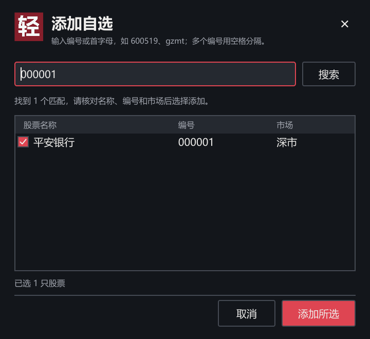

# 轻量看盘

轻量看盘是一款桌面端股票轻量看盘工具，让你在工作时也能查看股票行情。自选股列表显示现价、涨跌幅和成交量，鼠标移到股票名上即可查看分时走势、日 K、五档盘口和最近成交。

- **单文件运行。** Windows x64 正式版 **v2.0.11** 只有一个 EXE，无需安装 .NET 或 VC++ 运行库。
- **内存占用低。** Windows 11 上实测，跟踪 9 只自选股、每秒刷新时，行情小窗的专用工作集为 **13.1 MiB**，含共享页的总工作集为 **50.0 MiB**（v2.0.0 实测中位数）。
- **按需刷新。** 只在打开盘口时请求明细，隐藏到托盘后暂停行情请求，再次显示时立即刷新。

## 下载

**推荐 · 单文件运行**　下载 **LiteTicker.exe**，保存到桌面或常用文件夹，双击即可看盘。[下载最新版 EXE](https://github.com/Alexzzz2008/LiteTicker/releases/latest/download/LiteTicker.exe) · [代理下载](https://gh-proxy.com/https://github.com/Alexzzz2008/LiteTicker/releases/latest/download/LiteTicker.exe)

**备选 · ZIP 安装包**　下载并完整解压 ZIP，双击解压目录中的 **`install.cmd`**。安装器会创建桌面快捷方式并启动轻量看盘。[下载 ZIP 安装包](https://github.com/Alexzzz2008/LiteTicker/releases/latest/download/LiteTicker-win.zip) · [代理下载 ZIP](https://gh-proxy.com/https://github.com/Alexzzz2008/LiteTicker/releases/latest/download/LiteTicker-win.zip)

## 怎么用

1. **添加自选股。** 右键小窗，选择 **添加自选**。输入股票代码或拼音首字母，核对名称后勾选并添加。
2. **看行情和盘口。** 鼠标移到股票名上即可切换盘口，点 **固定** 可保持当前股票。普通股票分时图的黄线和黄色数字表示均价。上证指数（000001.SH）的白线表示指数点位，黄线表示上证领先。缺少领先数据的分钟会留空。五档挂单可切换手数或金额。
3. **调整小窗。** 拖动小窗或边缘可移动或缩放。右键打开 **设置**，可调字号、透明度、置顶和快捷键，在 **版本与更新** 中可检查新版。
4. **隐藏或退出。** 按 `Ctrl+Alt+Q` 显示或隐藏小窗，也可双击托盘图标恢复。要完全退出，在托盘菜单选择 **退出轻量看盘**。

自选股与设置保存在本机，更新后会保留。

## 界面预览

以下画面使用 2026 年 11 月 17 日 13:53 的腾讯行情快照。

查看设置与添加自选界面

