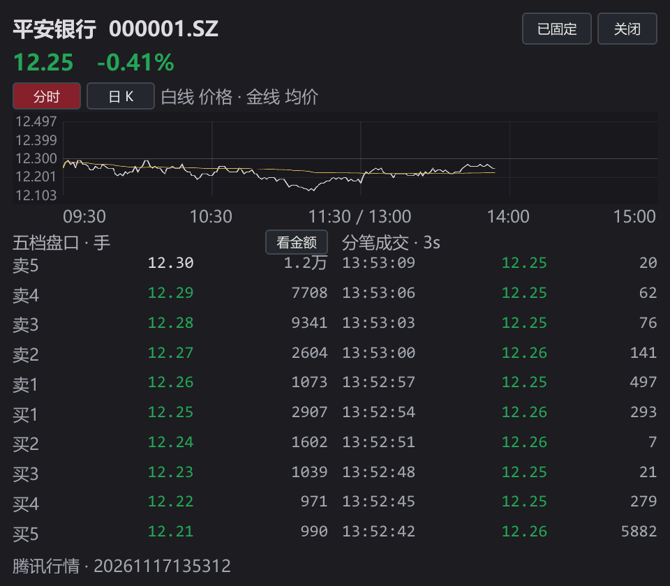

# 轻盘 · 桌面看盘助手

轻盘把股票行情、自选股和五档盘口放进一个可置顶的桌面行情小窗。鼠标停在股票名称上即可查看分时走势和最近成交。

**当前正式版为 v2.0.1，适用于 Windows x64。** 程序使用 Rust + Slint 和软件渲染，无需安装 .NET 或 VC++ 运行库。[GitHub 正式版](https://github.com/Alexzzz2008/LiteTicker/releases/tag/v2.0.1)

## 下载与使用

### 首次安装（推荐）

1. 下载 [Windows 安装包](https://github.com/Alexzzz2008/LiteTicker/releases/download/v2.0.1/LiteTicker-win.zip)。如果 GitHub 下载缓慢，可用[代理下载](https://gh-proxy.com/https://github.com/Alexzzz2008/LiteTicker/releases/download/v2.0.1/LiteTicker-win.zip)。
2. 右键 ZIP，选择 **全部解压**，然后双击解压目录中的 **`install.cmd`**。安装器会校验程序、创建桌面快捷方式并启动轻盘。
3. 下次双击桌面的 **“轻盘 · 桌面看盘助手”** 即可启动。新安装默认保存在 `%LOCALAPPDATA%\Programs\LiteTicker`。

### 免安装运行

将单文件程序保存到准备长期使用的文件夹，双击 **`LiteTicker.exe`** 即可启动。也可以直接运行上述安装包里解压出的 EXE。[下载单文件程序](https://github.com/Alexzzz2008/LiteTicker/releases/download/v2.0.1/LiteTicker.exe) · [代理下载](https://gh-proxy.com/https://github.com/Alexzzz2008/LiteTicker/releases/download/v2.0.1/LiteTicker.exe)

### 从 v2.0.0 更新

在行情小窗右键打开 **设置 → 版本与更新**，点击 **检查更新**，看到 **v2.0.1** 后选择 **下载并重启**。重启后回到此页，确认“当前版本”为 v2.0.1。此次修复了股票列表置顶时遮住设置窗口的问题。

### 从 v1.0.5 升级

1. 在 Windows 任务栏右侧找到旧版轻盘托盘图标，右键选择 **“退出轻盘”**。关闭窗口或按 `Alt+F4` 只是隐藏，不能代替退出。
2. 下载原生版的 `LiteTicker-win.zip`，完整解压后双击 **`install.cmd`**。这次跨技术栈升级需要手动安装，v1.0.5 内的“下载并重启”不能安装原生程序。
3. 原先装在 `D:\LiteTicker` 的程序会在原位置升级；其他自定义目录需要在解压目录打开终端，指定原路径，例如：

   ```powershell
   .\install.cmd -InstallDir "C:\Apps\LiteTicker"
   ```

4. 安装器保留被替换的旧 EXE 备份，不删除自选股或设置。新版直接沿用当前用户的 `%LOCALAPPDATA%\LiteTicker\settings.json`，无需重新添加自选。

### 启动、隐藏、退出与版本确认

- **启动：**安装版使用桌面快捷方式；免安装版双击自己保存的 `LiteTicker.exe`。再次启动会唤回已有窗口。
- **隐藏：**行情窗右键选 **“隐藏到托盘”**，或关闭窗口、按 `Alt+F4`。隐藏后暂停行情请求，程序仍在运行。
- **重新显示：**双击任务栏右侧的轻盘托盘图标，或在托盘菜单选 **“显示 / 隐藏”**；默认 `Ctrl+Alt+Q` 也可显示／隐藏。托盘图标可能收在任务栏的 **^（显示隐藏的图标）** 中。
- **完全退出：**托盘右键选 **“退出轻盘”**，或行情窗右键选 **“退出”**。升级或移动 EXE 前先完全退出。
- **确认版本：**行情窗右键选 **“设置”**，或托盘选 **“设置 / 快捷键”**，进入 **“版本与更新”**，查看 **“当前版本”**。本次升级完成后应显示 **v2.0.1**；以后以下载发布页的版本号为准。

## 体积与内存

Windows x64 单文件程序约 **11.7 MiB**，ZIP 安装包约 **6.1 MiB**。作为对照，v2.0.0 的 GitHub 下载件分别为 12,253,696 和 6,447,624 字节。1 MiB = 1,048,576 字节。

| Windows 11 实盘场景 | 专用工作集（中位数） | 总工作集（中位数） | 样本数 |
| --- | ---: | ---: | ---: |
| 仅行情小窗 | 13.1 MiB | 50.0 MiB | 60 |
| 行情小窗和设置窗口 | 16.5 MiB | 53.5 MiB | 24 |

测量使用 GitHub 下载的 v2.0.0，运行于 Windows 11 x64，系统缩放为 200%。程序加载 9 只自选股，通过腾讯接口每秒请求行情。两个场景分别观察约 51 秒和 23 秒，按同一进程的 Windows 工作集计数取中位数。专用工作集是进程独占的驻留物理内存，总工作集还包括共享页。自选数量、打开的页面和系统调度都会影响读数。

## 界面预览

行情截图取自 2026 年 11 月 17 日北京时间 13:53 的腾讯盘中行情快照。平安银行（000001.SZ）的分时曲线包含接口返回的 176 个分钟点，五档旁列出当时最近的 10 笔成交。

**桌面行情小窗**


**盘口、分时与五档**



**设置界面**


**添加自选**


## 功能

- 无边框深色小窗，紧凑显示名称、现价、涨跌幅、成交量四列；成交量以手为单位，较大数值使用万、亿缩写。
- 名称、价格、涨跌幅和成交量之间保留均衡空白，价格与数量分别右对齐；添加或删除自选时自动调整高度，超过 12 行可滚动查看。
- 窗口不显示按钮条和表头；左键拖动窗口，拖动边缘调整尺寸，右键管理自选。
- 输入股票代码或拼音首字母，查看名称后选择添加；支持批量代码、删除自选、上移与下移，保存列表顺序。
- 深色设置页使用红色强调、透明度滑条、置顶开关和可录入的快捷键；常规、字体、版本更新分区切换。
- 右键菜单、托盘菜单和添加自选页面统一为黑色、深红风格；菜单默认字号加大，并跟随全局字号缩放。
- 全局字号可调，行情列表和盘口可分别覆盖；字号与布局一起调整，保存后应用。
- 设置内显示当前版本，支持启动时自动检查和手动检查更新；下载校验通过后可重启更新，保留自选股和设置。
- 托盘常驻：隐藏后取消并暂停行情请求，重新显示立即刷新。
- 后台批量请求；同一轮刷新不重叠，切换数据源后丢弃旧请求的响应。
- 请求失败时保留已有有效报价，界面显示行情状态。
- 本地保存设置与窗口位置；重复启动只保留一个实例。
- 悬停股票或右键“查看盘口”打开大字侧边详情，支持分时、日 K、五档和成交；可固定、拖动和缩放，无横竖滚动条，空间不足时自动放在主窗左侧。
- 盘口打开即显示当前行情和缓存；鼠标停在其他股票名称上时切换未固定的盘口，单击选中后仍可继续悬停查看。近期成交按时间倒序显示十行，与五档买卖的十行并排对齐。
- 分时图按交易时间每小时画竖线，午休时段折叠；五档支持挂单手数／金额切换，金额按档位价格 × 手数 × 100 计算。
- 普通价格至少显示两位小数，仅在第三位有实际精度时保留第三位；刷新时价格列位置固定，数量位数变化不会挤动价格，底部时间保持布局稳定。

交易时段刷新间隔可选 1、2、3、5、10 秒，其他时间降为 30 秒。交易时段按北京时间和周末判断，暂不内置法定节假日日历。刷新间隔不等于行情接口的数据更新频率。

## 日常操作

- 左键拖动小窗，拖动边缘缩放；右键股票行可删除、上移或下移自选，右键菜单也提供添加自选和设置入口。
- 悬停显示盘口，移出后自动隐藏；点击“固定”保持显示，点击“关闭”停止详情请求。选中股票后按 `Enter` 也可打开并固定盘口。
- 默认 `Ctrl+Alt+R` 更新行情；行情窗右键和托盘菜单也有“更新行情”入口。
- 可在设置中录入其他快捷键，支持 `Ctrl+Q`、`Alt+R` 等两键组合，按 `Delete` 或 `Backspace` 禁用对应快捷键。快捷键被其他程序占用时提示冲突，不保存这次设置。
- 设置中的“窗口透明度（%）”保存后立即生效，范围为 60–100；100 表示完全不透明，数值越小越透明。
- “分笔更新（秒）”可选 2 或 3，独立于主窗行情间隔；仅盘口打开时请求，非交易时段降为 30 秒。
- “字体大小”中设置全局字号；列表、盘口选择“跟随全局”或单独比例。其他界面按全局字号显示。
- “版本与更新”中可关闭启动检查，或手动检查、下载并重启。检查失败不会影响行情；关闭设置会取消正在进行的更新请求。

重新显示小窗后立即请求新行情。

详情仅在打开时请求。分时缓存 5 秒、日 K 缓存 60 秒；切换股票或数据源会取消旧请求，迟到结果不会重新打开已关闭的盘口。腾讯五档直接复用批量报价，近期分笔按页表定位最新页，每轮最多两次请求，共用 4 秒超时，失败不会退回早盘页。无分笔而有分时数据时，成交区明确显示“分钟成交 · 非逐笔”。当前东财适配未提供五档；详情接口失败会提示并标记保留数据，不切换其他来源冒充数据。

公开源分笔可能合并多次成交，2／3 秒是请求频率，不等同于交易所 Level-2 逐笔推送；成交区以源返回的实际时间显示，不补造秒数。

本版可选腾讯和东财，默认使用腾讯；东财部分详情接口可能不可用。新浪尚未接入本版。

## 本地数据

设置与自选列表保存在 `%LOCALAPPDATA%\LiteTicker\settings.json`，不上传到 GitHub。原生版兼容 v1.0.5 的正式配置，保留自选顺序、数据源、字号、快捷键和窗口位置。复制此文件可迁移自选和设置；复制前先在托盘中退出轻盘。保存设置时先写临时文件，再替换原文件，并保留上一份 `settings.json.bak`。

已有正式配置时以它为准；若只使用过 Rust 预览且没有正式配置，首次启动会从同一用户的 `%LOCALAPPDATA%\LiteTicker-preview\settings.json` 复制自选和设置。

原生版的更新包来自本仓库的 GitHub Releases，下载后校验 SHA-256、大小以及原生程序身份和版本。替换程序时保留 `LiteTicker.exe.previous` 旧版备份；自选股和设置不包含在更新包中。
